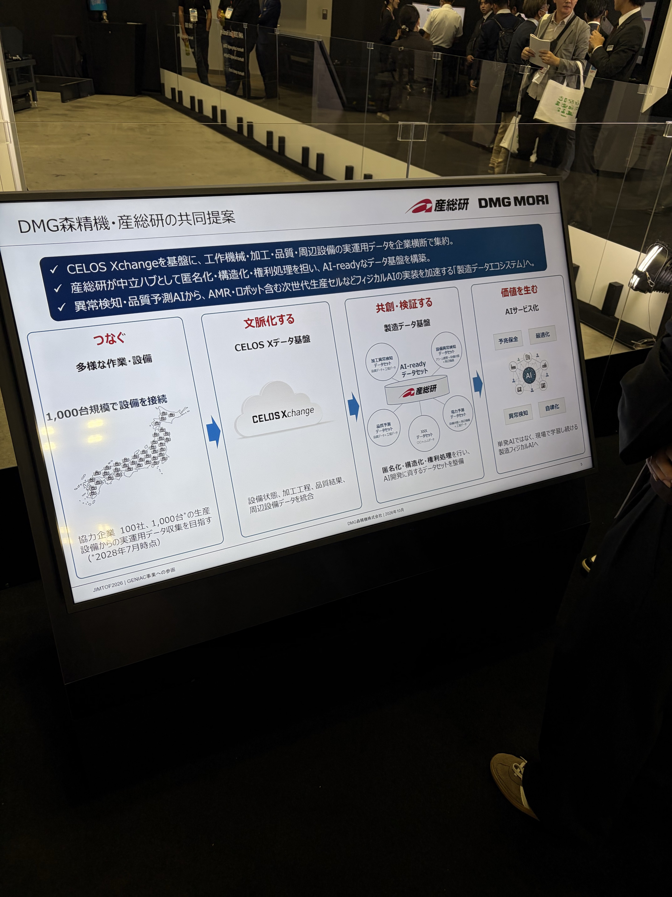
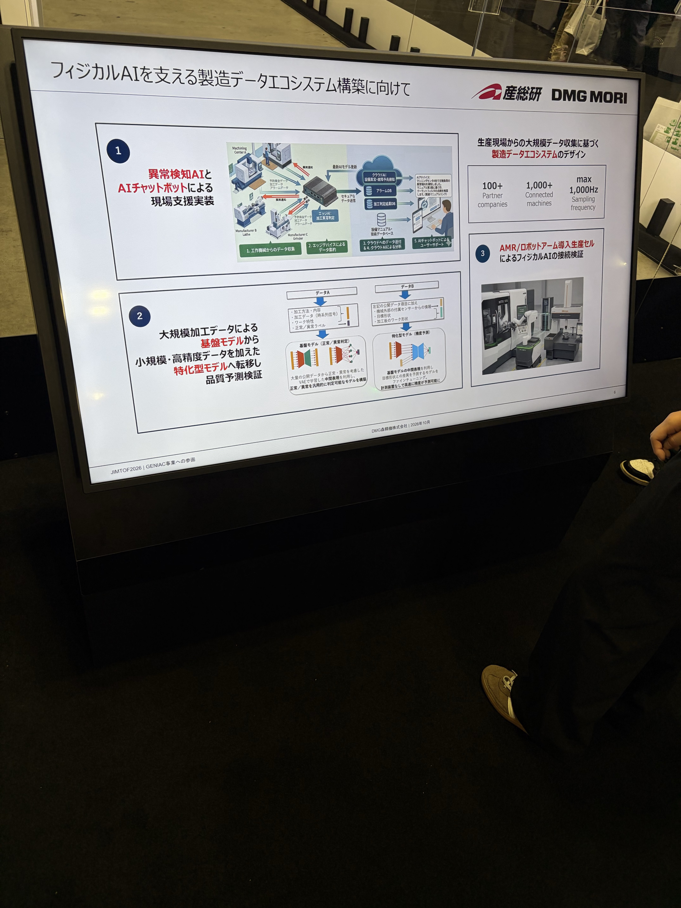

> 集約版への複製。作成当時の検討経緯を残し、本文中の「未公開」「受領後にHTML化」等は当時の状態を示す。今回の公開状態はREADME参照。ローカルリンクのみ本フォルダ内へ付け替えた。

# JIMTOF2026 追加議論まとめ

作成日：2026年10月28日  
対象：現地ヒアリング後の追加議論、DMG森精機・産総研の写真2点、その補足から検討した技術動向・仮説・定義。

**既存HTMLとは別の検討資料。写真等の追加資料は受領途中であり、HTMLへの統合は全資料を受け取ってから行う。** 既存の生メモ、写真読解、前版の分析は保持する。本資料は議論を整理した文章であり、発言の逐語記録ではない。

## 1. 現時点での主張

製造業の生成AIは、知識を検索して回答する利用から、機械・CAD/CAMのUIに組み込まれ、現在の設備状態と判断知識を使って、解析・シミュレーション・最適化等を利用する方向へ具体化している。

その成立には、次の四つを結ぶ必要がある。

1. **判断知識**：どの状態で何を疑い、何を確かめ、どう対処するか。
2. **製造の専門技術**：状態を捉え、結果を予測し、改善案を計算・検証するモデルやツール。
3. **設備・ソフトへの接続**：必要な情報を取得し、機能を利用し、条件に応じて実行へつなぐインターフェース。
4. **結果を残す運用**：問い・観測・判断・ツール・実行結果を結び、次の改善に使う仕組み。

DMG森精機の製造データ基盤・基盤モデル構想は、特に二つ目の専門機能を、多様なデータと共通表現から育てる方向として位置付けられる。さらに「製造版BERT」のように、複数タスクへ使える共通資産を形成しようとしている、という仮説を置ける。

ただし、共通表現を学ぶモデルが、そのまま言語で対策を考えツールを選ぶエージェントになるとは限らない。状態の理解、条件変更後の予測、対策の選択を分けて、どこまで実現したかを見る。

## 2. 2024年から2026年に何が変わったと考えるか

### 本人の現地所感

2024年は、知識をもとに回答するチャットボット型の生成AI展示が印象に残っていた。2026年は、機械・CAD/CAMの中にエージェントが入り、対話式の工程設計・プログラム作成、内部データを使った分析・判断支援へ適用が拡大していると感じた。

オークマ・三菱電機では、機械データと知識DBを組み合わせた原因分析・対策提案の説明があった。ファナックでは、設備状態・解析・デジタルツインをエージェントへ接続する構成が具体的だった。

### 公開資料との照合で調整する点

三菱電機の2025年1月24日付講演資料・印刷頁8には、JIMTOF2024の生成AIトラブルシューティングアプリが掲載されている。図には装置データを使う解析や、利用を通じて学習する将来像も記載される。

したがって、世代差は次のように書く。

> **2024年にも構想は示されていたが、2026年には生成AIの適用範囲が広がり、製品UIへの組込み、実データ参照、専門ツールの利用、設備操作との接続が具体化している。**

「2024年は回答のみ」「設備データ連携が2026年に初めて登場」とはしない。また、同資料の社内文書検索用RAGと、JIMTOF2024のアプリは別項目であり、そのアプリがRAG方式だったと確定する資料ではない。

出典：[三菱電機講演資料・印刷頁8](https://elsi.osaka-u.ac.jp/system/wp-content/uploads/2025/02/2_MitsubishiSekiguchi_ELSIForum2024_forWEB.pdf#page=8)、[JIMTOF2024公式出展説明](https://www.mitsubishielectric.co.jp/fa/events-seminars/exhibitions/2024/jimtof2024/index.html)。追加議論で本文・該当図を確認済み。展示全体の普及率や製品導入数の比較ではない。

## 3. 中心は「熟練者の判断知識をAIが使えるようにする」こと

### 対話履歴の保存だけに限定しない

熟練技能の形式知化とは、単に過去の会話を蓄積することではない。熟練者が持つ、次のような判断を洗い出し、AIが利用できる形にすることが中心になる。

|判断知識の要素|整理する内容|
|---|---|
|目的・適用条件|何を改善するか。材料・工具・設備・加工区間・要求品質は何か。|
|着目する観測|どの信号・測定値・履歴を見るか。情報が足りない場合に何を追加確認するか。|
|原因の切り分け|どの状態から何を疑い、候補をどう区別するか。|
|対策の選択|何を、なぜ、どの順序で試すか。|
|ツールの使い分け|どの計測・解析・最適化機能を使い、結果をどう読むか。|
|制約・例外|どの条件では適用しないか。何を人が承認し、どこで止めるか。|
|結果の評価|何が変われば有効と判断するか。失敗時の次の確認は何か。|

取得経路には、熟練者への聞取り、作業観察、不具合対策票、過去の加工事例、工程・条件の選択理由、対話履歴などがある。対話履歴はこのうちの一つであり、まだ会話に現れていない知識や、無意識に省略される前提も洗い出す必要がある。

### 接続インターフェースと判断知識は対になる

|整備するもの|役割|
|---|---|
|設備・解析機能へのインターフェース|何の情報を取得し、何の機能を実行できるかを示す。|
|形式知化した判断ナレッジ|いつ、なぜ、その情報や機能を使うべきかを示す。|

基本となる流れは、次のように整理できる。

**問い・要求＋観測状態 → 判断知識 → 原因仮説・追加確認 → 対策・ツール選択 → 解析・検証 → 承認・実行 → 結果確認**

この流れのどこをAIが担当し、どこに人が残るかは製品ごとに異なる。全てが無人で実行されるという意味ではない。

## 4. 各社が工夫している「AIへの知識の渡し方」

|企業|ヒアリング・補足からの理解|まだ確定していない点|
|---|---|---|
|マザック|何でも渡すと回答精度が落ちるため、入力や条件から参照すべきDBを絞る。RAGベースとの説明。|具体的な知識構造や接続方式。原文の「API(多分MCP)」をMCP採用確定にしない。|
|オークマ|RAGも一部利用し、タスクに応じて必要な参照先を選ぶ工夫。機械状態と知識DBを使う。|参照選択の内部方式と、全体のアーキテクチャ。|
|三菱電機|RAGを含め、保存した対話・状態等の情報をどの形で再利用するかを模索。|構造化・再利用・学習の実装範囲。|
|ファナック|ナレッジとして判断知識を登録し、問いと機械状態から対策・ツール選択へつなげる機能だと本人は理解した。|ナレッジの具体的形式や提供方法。一般のMCP標準機能との対応。|

知識の表現、参照方法、外部機能との接続は別の設計軸である。例えばMarkdownは表現形式、RAGは必要な情報を検索して参照させる方法、MCP等は外部機能への接続手段として整理でき、併用も可能。

今回の主張は、**「MCPが全社必須」ではなく、「エージェントが設備・解析機能を利用できるインターフェースの整備が重要」**とする。ファナックのナレッジ機能を、そのままMCP標準の共通項目と認定しない。[MCPの参照仕様](https://modelcontextprotocol.io/specification/2025-06-18/server)はPrompts・Resources・Toolsという区分を示す。

## 5. 業務を使う過程で、文脈付きのデータを作れる価値

本人が提示した重要な仮説は、エージェントの導入により、従来は機械・ソフト・担当者ごとに分散していた情報が、一連の課題解決として関連付けられるようになる、というもの。

価値は、その場の回答・操作だけでなく、**何を問題とし、何を観測し、何を根拠に判断し、どのツールを使い、何を実施したかを同じ文脈で残せること**にある。

|結び付けたい情報|再利用する意味|
|---|---|
|案件・機械・ワーク・工具・加工区間|何の対象で生じた問題か特定する。|
|観測状態・時刻・参照データや知識の版|判断時点の前提を再現する。|
|原因仮説・対策候補・選択理由|結果だけでなく判断の経緯を残す。|
|呼び出したツール・入力・出力|解析や検証の再現条件を残す。|
|人の修正・承認・却下・実際の適用条件|提案と実行を区別する。|
|実行後の品質・作業時間・工具状態・失敗|その判断や対策が有効だったか評価する。|

二つの循環を分けて考える。

1. **課題解決の循環**：問い・状態 → 判断知識 → 専門ツール → 検証・対策・実行。
2. **能力を育てる循環**：その記録と結果 → 評価・構造化 → 知識・モデル・ツールを改良 → 次の課題解決。

この意味で、エージェントは「製造知識を使う仕組み」であると同時に、「現場の判断を次の改善に使える記録へ変える入口」にもなる。

ただし、**使うだけで学習可能なデータセットが自動的に完成する、とまでは言えない。** 案件・対象ID、時刻、版、実行結果の保存が必要。対話保存、検索による再利用、モデルの再学習、実行時の自動更新は別の段階として評価する。既存のデータ統合システムがなかったという意味でもない。

## 6. DMG森精機・産総研の写真から確認できた内容

### 製造データ基盤の構成（写真2・資料印刷頁5）

- CELOS Xchangeを基盤に、工作機械・加工・品質・周辺設備の実運用データを企業横断で集約する。
- 産総研が中立ハブとして、匿名化・構造化・**権利処理**を担い、AI-readyなデータ基盤を構築する。
- つなぐ → 文脈化する → 共創・検証する → 価値を生む、という流れを示す。
- 加工異常検知・設備異常検知・品質予測・電力予測等のデータセットを例示。
- 協力企業100社・1,000台の設備からのデータ収集を目指し、2028年7月の注記がある。現時点での達成数として扱わない。

本人の補足にある「権利化」に対応する写真の表記は「権利処理」。利用条件の整備を含むと考えられるが、特定企業の独占的権利化と断定しない。

### 予測モデルと現場支援への展開（写真1・資料印刷頁6）

|取組|写真から確認できる内容|
|---|---|
|① 現場支援|異常検知AIとAIチャットボット。機械データをエッジ・クラウドへ集約し、判定結果・アラーム・マニュアル等を使う構成。|
|② モデルの転移|大規模加工データによる基盤モデルから、小規模・高精度データを加えた特化型モデルへ転移し、品質予測を検証する。|
|③ 実機接続|AMR／ロボットアームを導入した生産セルによるフィジカルAIの接続検証。|

②の小さな説明文には、**VAEで学習した中間表現**を利用することが書かれている。基盤側は正常／異常判定、特化側は精度予測として図示される。

学習データAは加工方法・内容、時系列信号、ワーク特性、正常／異常ラベル。データBには追加センサー、目標形状、加工後のワーク形状等も挙げられる。基盤モデルの中間表現を使い、目標形状との差異を予測するモデルをファインチューニングする説明である。

「計測機器なしで高速に精度が予測可能に」という訴求は、推論時の品質推定の狙いとして読む。学習用の正解計測や定期的な性能検証まで不要になったとはしない。

既存ヒアリングの「データを集め始めた段階」という説明と、写真の将来目標は整合する。ただし①②③は取組項目であり、番号だけで「①は完成・②は未着手」という時系列にはしない。

## 7. AI-ready化を共通の開発課題として捉える

AI-ready化は、何をAIにさせるかによって整備するものが異なる。

|用途|必要な整備|狙い|
|---|---|---|
|製造モデルを学習するデータ|信号・単位・時刻・加工区間・工具・材料・設備・品質ラベルの対応、利用権、評価データの分離。|状態・品質の特徴を学び、対象タスクへ適応する。|
|エージェントが使う判断知識|症状、根拠、適用条件、原因の切り分け、対策、ツール選択、例外・承認条件。|問いと観測状態から、次に何をするか導く。|
|AIから使う解析・最適化機能|入出力の意味、適用範囲、誤差、呼出し方法、実行条件、結果の読み方。|専門機能を適切に利用し、結果を判断へ結ぶ。|

DMG森精機・産総研の取組は特に学習データ側を支える。ファナックのナレッジについての議論は判断知識側を指す。両者を「同じ形式に揃える」というより、それぞれの目的に合う準備を接続していく、と整理する。

匿名化・構造化・権利処理が済むことと、特定タスクの学習・判断に十分な情報が揃うことも区別する。

## 8. 「製造版BERTを作る」という仮説

### 比喩として有効な理由

**大量のデータで共通表現を学び、個別タスクへ再利用する戦略という意味で、製造版BERTという比喩は近い。**

|BERTの考え方|製造版として想定する対応|
|---|---|
|大量の文章から文脈の表現を学ぶ|多様な設備・加工の条件、信号、ワーク特性、品質から共通表現を学ぶ。|
|学んだ表現を複数の言語タスクに使う|加工状態の表現を、異常判定・精度予測等に使う。|
|用途に応じて追加学習する|少量の対象データで、新しい設備・品種・用途へ適応することを狙う。|
|個別タスクの開発を効率化する|顧客追加のたびに必要なデータ取得・注釈・調整の負担を減らすことを狙う。|

VAEとBERTは方式が違うが、「共通の学習成果を複数の仕事の基盤にする」という戦略上の類似を否定する理由にはならない。一方、BERT型のネットワークや学習方法を実装している、という意味では使わない。

基盤モデルとは、広いデータで学び、複数の下流タスクへ適応できる共通モデルという考え方。LLMだけに限定されない。今回のメーカーの呼称と、どこまで汎用性が実証されたかは分けて見る。

### 一段踏み込んだ戦略仮説

DMG森精機は、一つの異常検知器を作るだけでなく、**製造向けAIを複数用途へ展開するための共通資産**を作ろうとしているのではないか。

個別モデルを設備・工場・用途ごとにゼロから開発すると、その都度データ収集、注釈、調整が必要になる。共通表現を活用できれば、顧客ごとの高精度データを追加し、より少ない工数で用途別モデルを立ち上げられる可能性がある。

この仮説が成立すれば、競争力は単一モデルの精度だけでなく、次の三点に広がる。

1. どれだけ多様な加工・設備・品質をカバーするデータがあるか。
2. それらを別の設備や用途にも通用する共通表現にできるか。
3. 新規タスクをどれだけ少量データ・少工数で立ち上げられるか。

転移学習自体が新しいという主張ではない。既知の学習方法を、企業横断のデータ基盤、継続的なサービス開発、現場への展開と組み合わせることに、産業上の意味があるという仮説である。

## 9. フィジカルAI・基盤モデル・エージェントを分けて定義する

|用語|本検討での意味|注意する境界|
|---|---|---|
|基盤モデル|広いデータから学び、複数のタスクへ適応可能な共通モデル。|特定の方式や、言語推論能力を必須としない。|
|フィジカルAI|物理状態を認識・予測し、目的・制約に応じた判断を、設備やロボットの動作へ結ぶ仕組み。|本調査の作業定義。メーカー間で統一された認証基準ではない。|
|AIエージェント|目的・状態・知識を踏まえ、必要な情報やツールを選び、課題解決の処理を進める構成。|どの処理を自動化し、人の承認をどこに残すかは実装ごとに異なる。|
|製造版BERT|製造データで共通表現を作り、個別の製造タスクへ再利用する戦略を表す比喩。|そのモデル自体が言語で対策を考え、ツールを呼ぶことまでは含意しない。|

基盤モデルは学習・再利用の軸、フィジカルAIは物理世界の判断・実行という軸である。両者は重なり得るが、同じ意味ではない。

今回の図②は、フィジカルAIを支える状態表現・予測の基盤と位置付けられる。③の生産セル接続は、それを判断・実行へつなぐ検証として読む。ただし、モデル単体の性能とシステム全体の自律性は別に評価する。

## 10. 共通モデルが対策まで考えるようになるか

ここでは三段階を分けると、発展仮説が明確になる。

|能力|解く問い|今回の資料との関係|
|---|---|---|
|状態の表現・判別|今はどんな状態か。異常か。|正常／異常判定を明示。|
|条件変更後の結果予測|送り・回転数等を変えたら、品質や状態はどうなるか。|品質予測への展開は示されるが、操作を条件にした将来予測の範囲は未確認。|
|対策・方策の選択|要求・制約を踏まえ、何を変え、どのツールで確認するべきか。|図②のモデルにこの能力があるとは確認できない。|

二段階目へ進めば、単に状態を判定するモデルから、対策候補の効果を比較するためのモデルへ近づく。これを最適化やエージェントと組み合わせることで、対策の選択を支えられる可能性がある。

ただし、通常運転の状態と品質の相関を学ぶことから、条件を変更した効果や原因を自動的に理解できるとはしない。操作・条件と結果の関係、有効範囲、必要な検証を確認する必要がある。

### 「判断ナレッジを渡さなくてよくなる」という予想について

製造知識がモデルに内在化されれば、毎回外から与える情報や個別開発の一部を減らせる可能性はある。ただし、学ぶ能力はデータと学習目標によって異なる。

加工信号・正常異常・品質を学習しただけで、必ず「原因を分けるための質問」「対策の優先順位」「呼ぶべきツール」まで身に付くわけではない。**加工状態の共通表現と、課題解決を進める判断手順との間には橋渡しが必要**になる。

将来は、対策・ツール利用・実行結果まで含む学習によって、判断の一部をモデルへ内在化する方向も考えられる。また、共通の製造表現、用途別予測モデル、最適化、言語エージェントを組み合わせる構成もあり得る。

最新の設備状態、顧客固有の制約、利用できるツールの仕様、承認条件などを外部から取得・参照する仕組みは、その場合も重要になる。

## 11. 加工現象の解明・モデル化が競争力として残る理由

エージェントが適切なツールを選んでも、呼び出したモデルの予測精度・適用範囲を超える結果は得られない。現象を説明するモデル、信頼できる観測、制約下で有効な条件を計算する技術が、課題解決の質を支える。

したがって、継続して高度化する対象は次のようになる。

- 加工状態・工具状態を捉える計測と推定。
- 加工現象のモデル化、パラメータ同定、校正。
- 品質・工具寿命・生産性を予測する技術。
- 計算の高速化、最適化、実機への適用条件。
- モデルの誤差・適用外を評価するデータと検証。

各社にエージェントの共通構成が見えても、内部の判断知識、専門ツール、実機接続、検証、応答時間、費用が同じとは限らない。モデル名やチャットUIだけで比較せず、これらの製造固有部分を比較する。

## 12. 自然言語UIの位置付け

各社が自然言語による指示を訴求していた点は、製造業務との親和性を示す観察である。利用者は、個々のソフトの操作へ目的を翻訳する代わりに、「何を改善したいか」から支援を受けられる可能性がある。

**自然言語は目的を伝える入口、判断知識は対象と対策を結ぶ基準、専門ツールは検証・解決の手段**と整理できる。

未熟練者にとっての操作負担を下げるというニーズ仮説は妥当。一方、目的を材料・工具・品質・設備制約へ具体化する途中では、不足情報を質問し、判断根拠や承認内容を示す必要がある。音声入力と自然言語対話は同じではなく、文字による対話でも価値は成立する。

効果を見る際は、経験別の完了時間、操作数、聞き直し、誤操作、専門家介入、結果の妥当性を比較する。

## 13. 写真によって更新・保留した事項

|論点|今回の整理|
|---|---|
|VLMとVAE|以前のH007にはVLMという記録があるが、今回の図②の記載はVAE。写真の説明はVAEとして扱い、生メモは変更しない。同一モデルの聞取り違いか別モデルかは未確認。|
|モデルの適応方法|中間表現利用とファインチューニングは図示。固定する層、付け替える部分、更新範囲、規模、損失関数は不明。|
|データ収集規模|100社・1,000台は目標として扱う。2028年7月の注記があり、現時点の収集達成数にはしない。|
|開発の進み方|①②③は取組項目。番号から完了順・商用化済み・未着手を推定しない。|
|品質計測の省略|推論時の精度予測という狙いと、開発・検証時に実測が必要なことを分ける。|
|基盤モデルの汎用性|異なる設備・材料・工具への転移効果、データ削減量、立上げ工数は未検証。|
|自律化の到達点|提案、仮想検証、人の承認、実機適用、加工中の自律制御を区別する。|

## 14. 最終報告へ入れる仮説文案

### 技術動向

2024年に示された生成AIによる製造支援の構想が、2026年には機械・CAD/CAMのUI、実データ参照、専門ツールの利用へ具体化している。熟練者の判断知識と設備状態をエージェントへ渡し、解析・シミュレーション・最適化を利用することで、個別の課題解決を支援する方向である。

### データ循環の価値

エージェントは、既存の知識とツールを利用するだけでなく、課題・観測・判断・実行結果を同じ文脈で残す入口にもなる。適切な紐付けと評価を備えれば、日常の利用が判断知識・加工モデル・ツールの改良につながり得る。

### 製造基盤モデルの仮説

DMG森精機の取組は、加工・設備・品質のデータから共通表現を学び、個別用途へ再利用する「製造版BERT」に相当する共通資産を狙うものと解釈できる。状態把握から品質予測、さらに条件変更後の結果予測へ広がれば、最適化やエージェントの判断を支え、フィジカルAIの基盤となる可能性がある。その転用範囲・工数削減・性能は、追加の検証を要する。

## 15. 仮説を強めるために確認すること

1. 共通表現を使うと、タスクごとのゼロからの学習より、精度・必要データ・立上げ工数が改善するか。
2. 学習に含まれない設備・材料・工具にも、少量の追加データで適応できるか。
3. 状態判定だけでなく、条件変更後の品質・工具状態の予測まで扱えるか。
4. 予測結果を、どの最適化・対策判断・設備制御へ返すか。
5. エージェントの対話と、実際に適用した条件・結果を案件単位で追えるか。
6. 熟練者の判断知識を何から獲得し、誰が検証・更新するか。
7. 顧客別の権利・制約を守りながら、知識やモデルのどの部分を共通利用できるか。

## 参照先

### 本人の補足・既存の検討

- [判断知識についての本人追補R001](../raw/R001.txt)
- [2024年比較・データ循環についての本人追補R002](../raw/R002.txt)
- [DMG写真についての本人補足原文](../raw/P001.txt)
- [写真に即した読解・留保事項](dmg.md)
- [製造版BERT・フィジカルAI定義の検討](bert.md)
- [現地7社のヒアリング原文](../raw_memos.md)

### 技術概念の補助資料

- [BERT原論文](https://arxiv.org/abs/1810.04805)：事前学習した共通表現と、下流タスクへの適応。
- [基盤モデルを論じるStanford CRFMの論文](https://arxiv.org/abs/2108.07258)：広いデータによる学習と下流タスクへの適応。
- [VAE原論文](https://arxiv.org/abs/1312.6114)：潜在変数を利用するモデル・学習の枠組み。
- [NVIDIAのPhysical AIの説明](https://www.nvidia.com/en-us/glossary/generative-physical-ai/)：物理世界の知覚・理解・行動という企業による説明。
- [産総研の製造AX拠点発表](https://www.aist.go.jp/aist_j/news/pr20260702.html)：製造データ取得・構造化・AI開発と現場還元の位置付け。

上記は追加議論で参照した資料。本ファイル作成のために全原典を再取得・再精読したという意味ではない。一般概念の説明からDMG固有の実装・性能を認定せず、写真の記載、現地説明、分析上の仮説を区別する。
